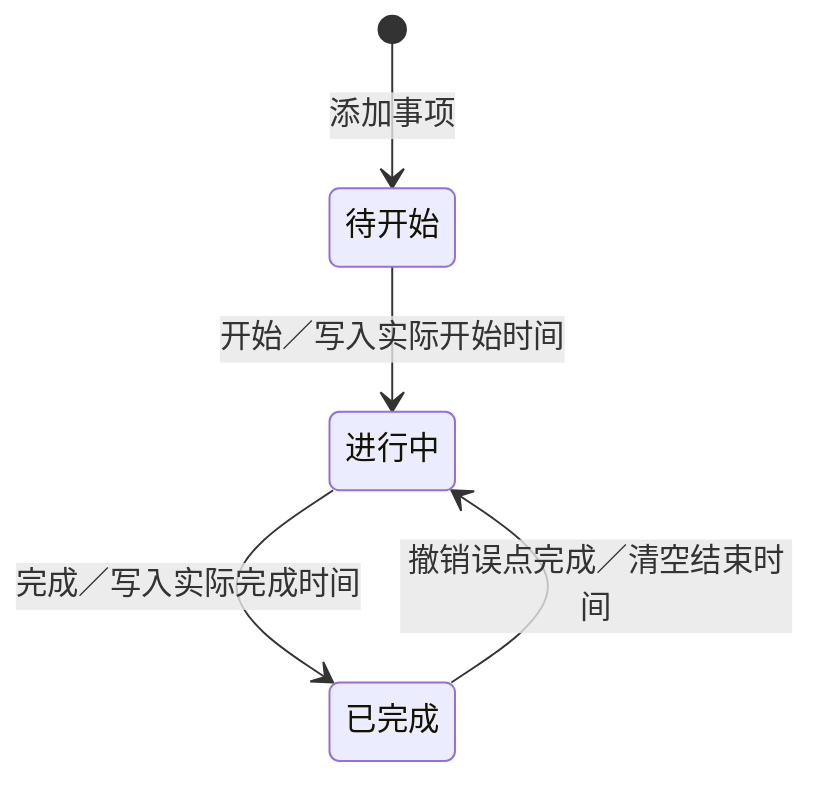
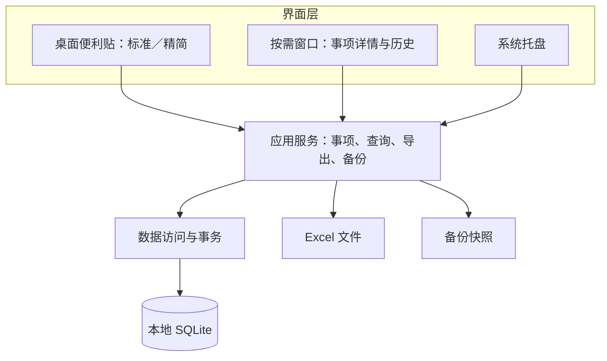

# 今日笺｜Windows 每日办公事项工具设计方案

> 开发前确认的设计基线。实现与测试状态以仓库 README、Actions 和 Release 测试报告为准。

版本：V0.4 第一版原样保留的双模式评审稿
日期：2026-10-28
交付范围：产品范围、交互与视觉设计、应用架构、数据模型、导出规则、验收要点。尚未开发 Windows 程序。

## 1. 产品定位与设计结论

一个放在 Windows 桌面上的个人工作便利贴。早上写下今天的重要事项，白天点击开始、完成，月底导出历史记录。

推荐采用单机、单用户、本地优先的桌面程序。直接保留最初交付的第一版原始界面作为默认“标准模式”，第二版原始精简界面作为可切换的“精简模式”。第一版的配色、字号、间距、卡片、时间与按钮排布，以及完整的今日规划、历史与导出页面均以原始设计稿为基准；在标题栏增加“精简”切换入口。两种模式共用同一份事项、时间记录和导出能力。

首次使用默认标准模式；点击原版便利贴标题栏“精简”进入第二版，在精简模式“⋯ → 切换到标准模式”返回。后续启动恢复上次选择。两种模式都支持桌面常驻、拖动和调整大小，并分别保存窗口位置与尺寸。

“轻量”的目标是操作少、常驻资源可控、无需服务器或账号。首版不引入协作、云同步、AI、项目管理、附件、复杂分类或提醒系统。尺寸、资源占用与启动速度需以最终发布包在目标电脑上的实测为准。

## 2. 需求与设计映射

| 用户需求 | 首版设计 |
|---|---|
| 早上填写重要事项 | 便利贴底部直接输入，连续回车新增；点击事项名称编辑详情 |
| 预计开始、结束时间非必填 | 事项标题为唯一业务必填项；两个计划时间分别可空 |
| 桌面像便利贴一样展现 | 默认沿用第一版 390 DIP 宽的便利贴和原始内容排布，可切换第二版约 340 × 360 DIP 的精简模式 |
| 给用户两种选择 | 第一版原样默认启用，标题栏切换精简模式，记住上次选择 |
| 支持调整窗口大小 | 两种模式四边与四角均可拖拽缩放，各自记住位置与尺寸 |
| 点击开始，自动记录时间 | 待开始 → 进行中；事务写入 actual_started_at |
| 点击完成，自动记录时间 | 进行中 → 已完成；事务写入 actual_completed_at |
| 按日期保存所有事项 | SQLite 单库保存，按归属日期分组、按日期索引查询 |
| 月度导出 | 按归属月份导出 .xlsx，包含事项明细与每日汇总 |

以上为建议默认值：首次启动显示标准模式桌面常驻小窗，置顶关闭、开机启动关闭；置顶与开机显示均可在设置中修改，偏好在两种模式间共享。关闭管理窗口不会关闭便利贴，隐藏便利贴后程序仍在托盘驻留。首版优先 Windows 11 x64，其余 Windows 版本与 ARM64 如有需要，需在开发前确认兼容范围。

## 3. 核心流程与状态规则

### 3.1 早上规划

启动 → 按已保存模式显示今日事项和未完成延续事项 → 在底部输入标题并按 Enter → 立即保存。标准模式也可通过“规划今日”集中录入标题、预计时间和备注；精简模式点击事项名称补充预计时间。两种方式写入相同事项集合。

- 标题去除首尾空白后不可为空，建议上限 200 字。
- 新事项默认归属于创建时的本机日期；今日页新增归属当天。
- 计划开始、结束可分别留空；只填结束时间也可保存。
- 首版计划时间按归属日期解释，二者都填写时要求结束晚于开始。跨夜计划暂通过备注表达；实际执行可跨日。
- 新增与编辑提供保存反馈；编辑采用明确提交，未提交离开时提示保留或放弃。

### 3.2 白天执行

- 开始：首次有效点击使用系统时间写入开始时间；重复点击不覆盖原时间。
- 完成：仅进行中事项显示主操作“完成”，点击写入结束时间。无需额外确认，短时提供“撤销”。
- 忘记开始：在事项详情中选择“补记完成”，填写真实开始、结束时间，禁止用系统编造的开始时间填充。
- 误点：完成后可撤销；误点开始或遗漏操作可在详情修正，记录修正前后值。
- 标题、计划时间和备注修改不改变实际时间。
- 默认允许多个事项同时进行，不强制结束上一个事项。
- 首版只有待开始、进行中、已完成三种状态；暂停、分段计时列为后续选项。

### 3.3 时间与统计口径

“事项历时”＝实际完成时间－实际开始时间，包含会议打断、休眠与其他间隔，不代表净工作投入。首版不展示“总工时”，不对重叠事项的历时求和作为工作量。进行中事项只展示开始时间，历时在完成后计算。

所有实际时间保存 UTC 时间、当时本地偏移与时区信息，界面和导出展示记录时的当地日期时间；归属日期作为独立业务字段保存，不因时区变化自动改变。计划时间保存归属日期下的本地时间及对应时区。时间修正校验结束不早于开始，检测系统时钟回拨导致的异常，不保存负历时。

### 3.4 跨日与异常

- 到次日保留原 task_id 与归属日期；仍未完成的事项在便利贴“延续事项”中出现，并标识来源日期。
- 延续是查询结果，不复制记录，避免月度重复统计。今日新建数与延续数分开显示。
- 关窗、退出、重启或电脑休眠不自动完成事项；启动时从数据库恢复状态。
- 跨日完成显示完整日期。月度导出归入原归属月份，完成时间可以位于次月。
- 关闭便利贴可隐藏到托盘；在托盘菜单“退出”才真正退出。首次隐藏有简短提示。
- 写入失败时不展示成功状态，保留输入供重试。
- 删除采用软删除，可恢复；默认历史和导出不包含已删除事项。

## 4. UI 与交互设计

### 4.1 视觉方向

暂用名“今日笺”。标准模式直接复用第一版原始界面，保留深暖色标题条、纸面底色、大日期、完成数量、进行中／待开始分区、卡片内部的两行排布、折叠与底部导航。进行中卡片保持第一行事项标题，第二行左侧开始时间、右侧完成按钮。完整今日规划保留原有列表与表单布局，完整历史与导出页保持原有结构。

精简模式直接保留第二版的“日期＋统一事项列表＋新增入口”，隐藏分区标题与常驻导航。进行中、待开始和已完成均通过文字、时间和操作表达，状态不只依赖颜色。双模式的差异只来自这两份已确认的界面，不另行重画一个近似第一版的默认界面。

采用 Windows 系统字体 Segoe UI／微软雅黑，正文约 14 DIP、辅助信息约 12 DIP；标准模式日期沿用第一版约 22 DIP，精简模式日期约 14 DIP。两种模式分别沿用原版间距、按钮大小和强调层级。支持系统浅色、深色主题与高 DPI 缩放。

### 4.2 桌面便利贴

| 区域 | 标准模式（默认，第一版） | 精简模式（第二版） |
|---|---|---|
| 标题栏 | 第一版应用名、置顶与折叠；增加“精简”入口，下方保持原版大日期与完成数量 | 第二版小日期、置顶与更多菜单 |
| 事项列表 | 保留进行中、待开始分区 | 统一紧凑列表，不显示分区标题 |
| 进行中事项 | 原版卡片：标题一行，开始时间与完成按钮另起一行 | 第二版浅底色行，按钮放在事项右侧 |
| 已完成 | 默认折叠，可展开查看实际起止时间 | 同样默认折叠 |
| 新增与导航 | 快速新增，并保留“规划今日”“历史记录”入口 | 快速新增；详细信息点名称编辑，其余入口收到菜单 |
| 模式切换 | 标题栏“精简” | “⋯ → 切换到标准模式” |
| 窗口边缘 | 四边与四角均可缩放 | 四边与四角均可缩放 |

标准模式初始宽度沿用第一版 390 DIP，首次高度按原版内容测量并限制在工作区内；示例四个事项时约 560 DIP。用户调整后保存实际大小，最小 260 × 360 DIP。精简模式默认 340 × 360 DIP，最小 260 × 220 DIP。用户拖动四边或四角自由调整宽高，不强制固定比例。放大时显示更多内容，缩小时标题自然换行、事项区独立滚动，新增入口保持可见，不整体缩小字体。最大范围随当前屏幕工作区确定。鼠标移到边缘显示系统缩放光标。

默认桌面常驻：关闭历史／详情窗口不影响便利贴；程序可在托盘持续运行，托盘提供显示／隐藏、退出入口。支持开机自动显示，并可选择始终置顶。默认不抢焦点，状态变化不弹出大窗。

两种模式分别记住位置、宽度、高度、所在屏幕与 DPI。切换前保存当前模式布局，切换后恢复目标模式布局；首次进入该模式使用默认尺寸。下次启动先读取上次模式，再恢复对应布局；多屏变化后限制在可见区域。这里的常驻采用独立 Windows 小窗与托盘生命周期，不嵌入 Explorer 桌面层；“显示桌面／Win+D”等操作遵循 Windows 窗口管理行为，隐藏后可从托盘恢复。系统行为需在目标 Windows 设备上验证，不能用浏览器设计稿证明原生常驻已实现。

模式切换不复制、清空或重新加载另一套事项，不重新计时，不改变计划时间、实际时间、状态或归属日期。快捷新增框中未提交的文字保留。历史窗口和导出是共同能力，不随模式减少；两种模式均可直接使用开始、完成与撤销。

### 4.3 今日规划

标准模式原样保留第一版“规划今日”的完整页面：事项列表与新增／编辑表单同时展示，表单含事项名称、预计开始、预计结束和备注。精简模式在底部直接新增，点击事项名称打开轻量详情。两种模式均能快捷新增、编辑计划、查看实际时间。计划和备注仍为选填，保存后同步刷新两个界面。事项删除、排序与时间修正放在详情或管理入口中，避免给每行增加一排按钮。

空状态仅显示简短提示和新增入口。键盘 Enter 新增，点击名称再按需填写时间；不要求填写完整计划才能开始工作。

### 4.4 历史记录与月度导出

标准模式原样保留底部“历史记录”入口和第一版完整历史与导出页面；精简模式通过“更多 → 历史与月度导出”打开同一个完整页面，返回便利贴时恢复精简模式。顶部选择月份，中间按日期分组显示事项，默认展示标题、状态、实际开始与完成时间；选择事项可进入详情并查看计划时间、备注与修正记录。月底点击“导出本月”，选择保存位置。

设计预览中的数据均为示例。“开始／完成／新增／导出设置”等交互用于检视流程，不连接数据库、不实际生成报表，也不代表 Windows 软件已经开发。

## 5. 应用架构

### 5.1 技术选型

| 层次 | 建议技术 | 选择理由 |
|---|---|---|
| 运行平台 | C# + .NET 10 LTS | 当前受支持的长期支持版本；适合单机桌面程序 |
| 界面 | WPF + MVVM | Windows 原生窗口体系，便利贴、管理窗口与托盘易于整合 |
| 应用服务 | 普通 C# 类 | 事项状态、历史查询、导出与备份统一处理 |
| 数据访问 | Microsoft.Data.Sqlite + 参数化 SQL | 直接操作本地 SQLite，避免为少量实体引入大型 ORM |
| 数据存储 | SQLite | 一个本地数据库即可持久化事项与操作记录 |
| Excel 导出 | Open XML SDK（建议） | 写出标准 .xlsx，不依赖本机安装 Excel；开发时验证版本与授权要求 |
| Windows 整合 | WindowChrome、托盘图标、窗口 Topmost、启动项 | 封装为窗口与生命周期服务，提供原生拖动缩放和常驻 |

技术依据：Microsoft 官方文档说明 WPF 为 Windows UI 框架；.NET 10 为 LTS；Microsoft.Data.Sqlite 为轻量 ADO.NET Provider。包大小取决于是否携带 .NET 桌面运行时及导出依赖，不在设计阶段承诺几 MB。

### 5.2 逻辑结构

运行时仅一个应用进程，不部署 HTTP 服务或后台常驻服务。进程中按功能分层即可，不拆微服务、不引入消息队列。便利贴和管理窗口通过已提交的数据变更通知同步。

### 5.3 开始／完成的可靠写入

界面命令 → 应用服务读取并校验状态 → 数据库事务中条件更新事项并写入事件 → 提交成功 → 两个窗口同步刷新。按钮执行中禁用；以状态／版本条件防止重复点击覆盖时间。状态和时间字段必须在同一个事务内提交。

系统时间通过统一 Clock 服务获取，便于验证跨日和时钟异常。历时基于已保存的时间计算，不依赖程序持续计时，不要求电脑一直开机。数据库操作通过串行写入队列执行；耗时导出和备份不阻塞界面。

### 5.4 桌面常驻与缩放设计

- 独立 WindowManager 管理便利贴、详情和历史窗口；应用退出由托盘“退出”显式触发，不随任意管理窗口关闭而结束。
- 便利贴采用 WPF WindowChrome 自定义简洁外观，保留原生标题拖动、边缘命中和缩放行为；建议边缘命中宽度约 6–8 DIP，四角可拖动。设置 ResizeMode 支持调整，SizeToContent.Manual，宽高由用户控制。
- 通过 MinWidth／MinHeight 限定最小尺寸；最大宽高动态参考屏幕工作区，不硬编码固定最大像素值。事项列表自适应可用空间，日期栏和新增入口固定。
- 窗口位置／尺寸变更后防抖保存，不每移动一个像素写数据库；保存显示器标识和 DPI 信息，恢复时转换并限制在当前可见工作区。
- 置顶与桌面常驻分别建模：常驻是程序及便利贴持续存在；Topmost 仅控制是否覆盖其他普通窗口，不定时抢焦点。
- 增加启动恢复、管理窗口关闭、托盘隐藏恢复、跨屏高 DPI、八方向缩放的 Windows 原生验收。浏览器稿仅验证外观和操作演示，不代替该验收。

### 5.5 双模式视图设计

- 一个便利贴宿主窗口、一个 TodayViewModel、一个事项集合；标准与精简使用不同视图模板，绑定相同开始、完成、编辑与导出命令，不建设两套业务逻辑。
- DisplayMode 取 standard／compact，首次默认 standard；切换只更新视图与用户配置，不触碰 tasks 的时间和状态字段。
- WindowManager 按模式保存窗口布局，并在切换时校验目标布局是否位于当前可见工作区。置顶、开机显示、主题和数据目录作为共用设置。
- 正在进行中的事项继续使用原开始时间；切换时不触发完成／开始命令，也不新增 task_events 业务事件。保存模式偏好不影响业务统计。
- 预览内可以切换模式、观察事项和窗口尺寸延续；跨进程重启恢复需开发后在 Windows 验证。

## 6. 数据模型

### 6.1 tasks：事项主表

| 字段 | 约束与含义 |
|---|---|
| id | UUID 主键 |
| task_date | 归属日期 YYYY-MM-DD，非空，按此归档 |
| title | 事项标题，非空 |
| note | 备注，可空 |
| planned_start_local / planned_end_local | 计划时间，可空，按归属日期解释 |
| planned_timezone_id | 计划时间采用的时区 |
| status | pending / running / completed |
| actual_started_at_utc | 实际开始时间，可空 |
| actual_started_offset_minutes / actual_started_timezone_id | 记录开始时的本地偏移及时区 |
| actual_completed_at_utc | 实际完成时间，可空 |
| actual_completed_offset_minutes / actual_completed_timezone_id | 记录完成时的本地偏移及时区 |
| sort_order | 同日展示顺序 |
| created_at_utc / updated_at_utc | 创建、更新时间 |
| deleted_at_utc | 软删除标记，可空 |
| version | 整数版本，用于条件更新 |

状态约束：pending 无实际开始、结束；running 有开始、无结束；completed 同时有开始、结束且结束不早于开始。补记完成必须提供有效的两个时间。

索引建议：task_date；(status, task_date)。延续事项查询原归属日期早于今天、未删除且状态非 completed 的记录。首版不允许随意修改归属日期；如后续增加“改期”，须记录事件并明确历史统计变化。

### 6.2 task_events：状态与修正记录

event_id、task_id、event_type、occurred_at_utc、old_values、new_values、source。记录新增、开始、完成、撤销、补记、修改与删除等操作，主要用于纠错和追溯，不默认给便利贴增加复杂操作入口。

### 6.3 app_settings：偏好设置

key、value、updated_at_utc。增加 display_mode（standard／compact，默认 standard），以及 window_bounds.standard、window_bounds.compact（分别包含位置／尺寸／屏幕／DPI）。置顶、开机显示、主题和最近导出目录为共同设置。窗口常驻与退出逻辑由 WindowManager 管理。数据库结构版本可使用 SQLite user_version 管理。

## 7. 本地存储、备份与发布

- 默认目录：`%LOCALAPPDATA%\JinRiJian\`；数据文件 `daily.db`，备份放在 `backups\`。
- 单用户目录配合 Windows 用户权限；默认不把业务数据上传到外部服务。
- 点击操作立即事务保存，不等待关机或退出时统一保存。
- 应用单实例运行；第二次启动唤回已有窗口，避免两个进程竞争操作。
- 每个有数据变更的日期最多生成一次自动快照，默认保留最近 30 份，支持“立即备份”和“恢复备份”。无变更不重复备份。
- 使用 SQLite 备份接口或关闭连接后的可靠快照，不在写入过程中直接复制单个数据库文件。
- 恢复时先校验备份可读性，备份现有数据库，再关闭连接替换并重新打开。
- 数据库升级前生成快照，迁移失败回滚并保留原始文件；程序升级不覆盖用户数据目录。
- 日志只记录错误码、时间与诊断上下文，不默认写事项正文。
- 发布优先提供自带运行时的 x64 包，减少电脑准备工作；如果目标电脑已安装匹配的 .NET Desktop Runtime，可另提供较小的框架依赖包。自带运行时版本的体积会更大，需实测。

## 8. 月度导出设计

文件名建议：`办公事项_2026-10.xlsx`。月份筛选条件是归属日期落在所选月的本机日期范围，包含未开始、进行中、已完成；默认排除软删除记录。导出时获取一致性快照，并在汇总页标注导出时间与统计口径。

### Sheet 1：事项明细

| 列 | 说明 |
|---|---|
| 归属日期 | 原 task_date |
| 事项名称 | 标题 |
| 状态 | 待开始／进行中／已完成 |
| 预计开始／预计结束 | 可空，展示日期及时间 |
| 实际开始／实际完成 | 可空，完整日期及时间 |
| 开始／完成时区偏移 | 跨时区记录可解释；通常均为 +08:00 |
| 事项历时（分钟） | 只有已完成且时间有效时填写，不汇总为工时 |
| 备注 | 用户补充内容 |
| 事项ID | 稳定标识，便于合并和查重 |

按归属日期、排序号输出。以文本单元格写出标题与备注，避免把以等号等字符开头的用户输入解析为公式。首行冻结，时间格式统一，正文换行。

### Sheet 2：每日汇总

归属日期、事项总数、已完成数、进行中数、待开始数、完成率。完成率＝已完成数／未删除事项总数；无事项日期留空，不填 0% 造成误解。月底仍进行中的事项保持原状；次月完成后再次导出原月份，会反映最新状态。

例如：10 月 31 日创建、11 月 1 日完成的事项，仍在 10 月明细中出现，完成时间为 11 月 1 日；不再作为 11 月新建事项重复统计。若将来需要“按完成月份统计”，应新增独立口径并明确命名。

取消保存不影响原数据；遇到文件占用时允许改名重试。先写临时文件，验证成功后替换目标文件，避免输出半个报表。空月份仍可生成含表头与“本月无事项”的文件。

## 9. 首版验收与后续选项

| 场景 | 应达到的结果 |
|---|---|
| 只填标题新增 | 可以保存，两个计划时间为空 |
| 只填一个计划时间 | 可以保存，不自动补另一个 |
| 重复点击开始／完成 | 不覆盖首次有效时间，不产生重复事件 |
| 开始后重启 | 状态与开始时间仍在 |
| 未完成过夜 | 今日显示延续标记，原日期仅有一条记录 |
| 月末跨日完成 | 按原归属月导出，完成日期准确 |
| 误点完成后撤销 | 恢复进行中，保留开始时间，清空结束时间 |
| 忘记开始后补记 | 用户填写真实开始与结束，修正记录可追溯 |
| 数据库写入失败 | 界面不假报成功，输入可重试 |
| 月度导出 | 状态、可空时间、中文、备注和汇总均正确 |
| 多屏切换与缩放 | 100%／150%／200% 下不裁切，窗口可见 |
| 自由调整窗口大小 | 四边与四角均可调整，最小尺寸时操作仍可见，列表可滚动 |
| 桌面常驻与恢复 | 关闭管理窗口后便利贴继续显示；托盘可隐藏恢复，重启恢复位置和大小 |
| 首次启动与模式记忆 | 首次为标准模式；用户选择精简后，下次恢复精简模式 |
| 第一版外观保留 | 默认模式复用原始三页面；原版配色、字号、间距、卡片与按钮位置对照一致，只增切换入口 |
| 运行中切换模式 | 事项、状态、原开始时间及未提交的快捷新增草稿保持一致，不复制记录 |
| 分别保存窗口布局 | 标准和精简各自缩放移动后，反复切换均恢复相应大小位置 |
| 备份恢复 | 恢复后事项数量、状态、时间一致 |

资源验收建议：目标机冷启动到可操作不超过 2 秒；空闲时 CPU 平均占用接近 0，拟定目标低于 1%；内存与包体积需在技术样机后制定上限。以上是待验证目标，不是已完成测试结果。

后续可按实际使用反馈增加暂停／继续与分段工时、重复事项、全局快捷键和 CSV 导出。当前评审只需确认窗口形态、信息密度、日期与导出口径；这些设计确认后再进入开发。

## 10. 技术参考

下列官方资料用于技术选型核对，查阅日期 2026-10-28：

1. [WPF 概述](https://learn.microsoft.com/en-us/dotnet/desktop/wpf/overview)：Windows UI 框架能力与平台范围。
2. [.NET 支持策略](https://dotnet.microsoft.com/en-us/platform/support/policy)：.NET 10 LTS 支持状态。
3. [Microsoft.Data.Sqlite 概述](https://learn.microsoft.com/en-us/dotnet/standard/data/sqlite/)：轻量 SQLite 数据访问组件。
4. [Open XML SDK 文档入口](https://learn.microsoft.com/en-us/office/open-xml/open-xml-sdk)：后续验证 Excel 文件生成方案。
5. [WPF WindowChrome](https://learn.microsoft.com/en-us/dotnet/api/system.windows.shell.windowchrome)：自定义外观下的原生拖动与边框缩放。
6. [WPF 窗口概述](https://learn.microsoft.com/en-us/dotnet/desktop/wpf/windows/)：尺寸、位置、置顶和缩放行为。

本方案中的布局、字段、交互默认值、架构分层与验收指标均为针对本需求提出的设计建议。
